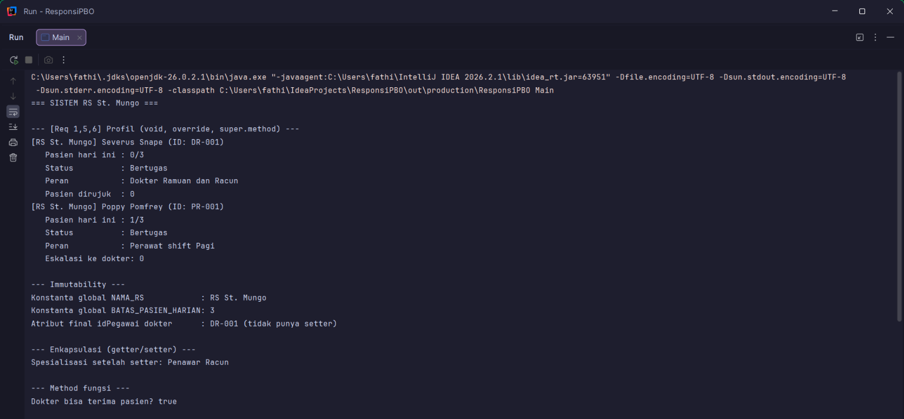
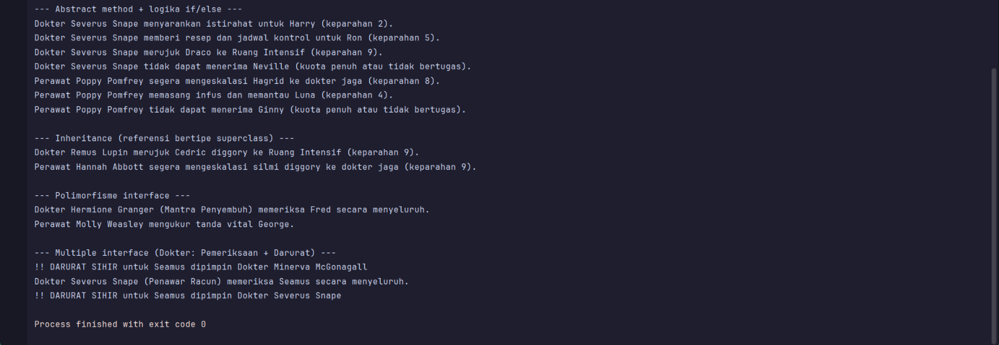

# Responsi Akhir Praktikum PBO — Sistem Rumah Sakit

## Identitas
<table width="100%">
  <tr><th align="left" width="30%">Data</th><th align="left">Keterangan</th></tr>
  <tr><td>Nama</td><td>Hanifah Silmi Fajri</td></tr>
  <tr><td>NIM</td><td>H1D025026</td></tr>
  <tr><td>SHIFT KRS</td><td>C</td></tr>
  <tr><td>SHIFT Baru</td><td>H-I</td></tr>
  <tr><td>Tema NIM (6)</td><td>Rumah Sakit</td></tr>
</table>

## Deskripsi Singkat
Sistem pengelolaan tenaga medis di **RS St. Mungo** (rumah sakit sihir di dunia Harry Potter).
Para tokoh seperti Severus Snape, Hermione Granger, Poppy Pomfrey, dan Molly Weasley bertugas sebagai
dokter dan perawat, menangani pasien (Saya sendiri (Silmi Diggory), Harry, Ron, Draco, dkk) sesuai tingkat keparahan (1-10)
dengan kuota pasien harian.

## Struktur Class

| File               | Peran                                                                                                      |
|--------------------|------------------------------------------------------------------------------------------------------------|
| `src/tenagaMedis.java` | Superclass **abstract**, memuat state, konstanta, constructor overloading, abstract method `tanganiPasien` |
| `src/dokter.java`      | Subclass, `implements pemeriksaan, darurat`                                                                |
| `src/perawat.java`     | Subclass, `implements pemeriksaan`                                                                         |
| `src/pemeriksaan.java` | Interface: `periksa(String)`                                                                               |
| `src/darurat.java`     | Interface: `aktifkanProtokolDarurat(String)`                                                               |
| `src/Main.java`        | Alur pengujian 10 persyaratan                                                                              |

## Pemetaan 10 Persyaratan
| No | Konsep | Lokasi                                                                                                       |
|---|---|--------------------------------------------------------------------------------------------------------------|
| 1 | State dan Behavior | `tenagaMedis`: atribut, `tampilkanProfil()` (void), `masihBisaMenerimaPasien()` (return)                     |
| 2 | Immutability | `NAMA_RS`, `BATAS_PASIEN_HARIAN` (`public static final`); `idPegawai` (`private final`)                      |
| 3 | Enkapsulasi dan Overloading | Semua atribut `private` + getter/setter, `this`, dua constructor di tiap class                               |
| 4 | Inheritance | `dokter` dan `perawat` `extends tenagaMedis`; `Main` terpisah; `tenagaMedis tm1 = new dokter(...)` di `Main` |
| 5 | Super Chaining | `super(...)` di constructor subclass; `super.tampilkanProfil()`                                              |
| 6 | Method Overriding | `@Override` pada `tampilkanProfil()` di subclass                                                             |
| 7 | Abstract Class | `tenagaMedis` abstract, `tanganiPasien()` abstract                                                           |
| 8 | Logika State Percabangan | `tanganiPasien()` di subclass: if/else atas kuota dan keparahan, mengubah jumlah pasien                      |
| 9 | Polimorfisme Interface | `pemeriksaan p1 = new dokter(...);` di `Main`                                                                |
| 10 | Multiple Interface | `dokter implements pemeriksaan, darurat`; `darurat d = new dokter(...)` di `Main`                            |

## Compile dan Run (Terminal)
Butuh JDK 8 atau lebih baru.

```bash
   cd src
   javac *.java
   java Main
```

## Screenshot Luaran


